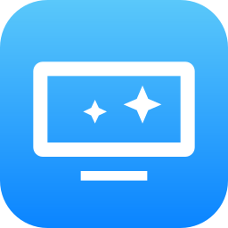
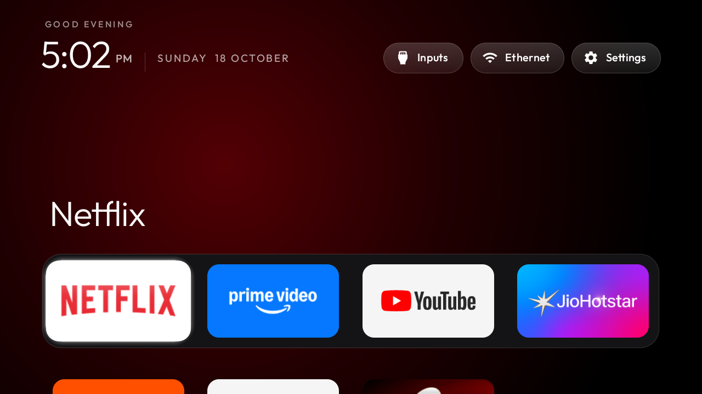
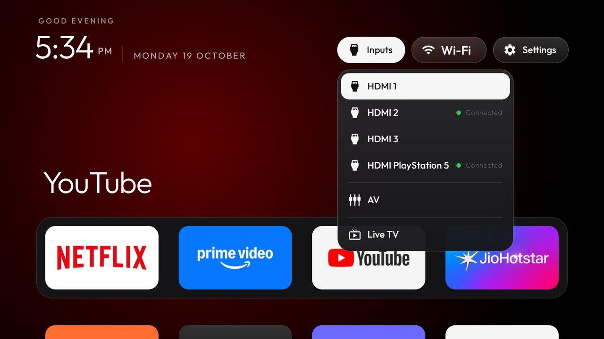
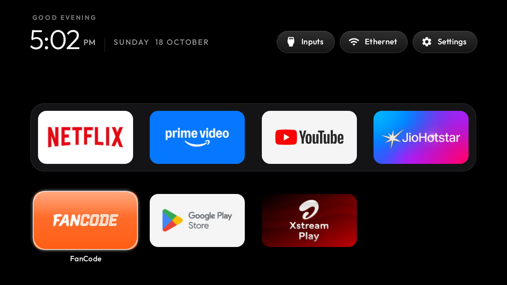
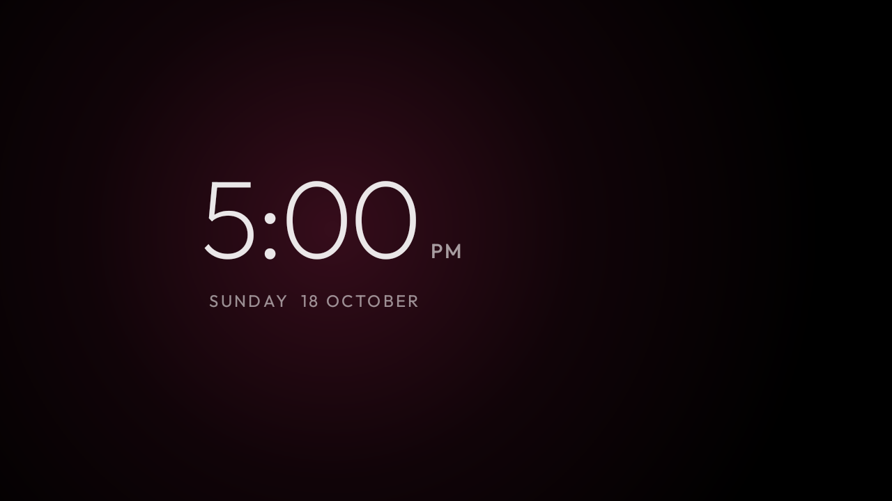
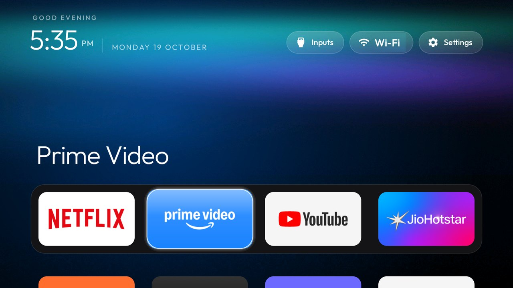
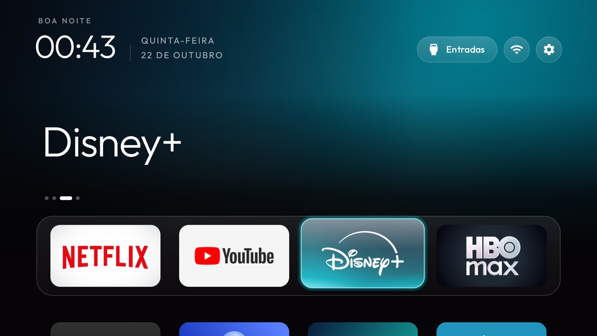
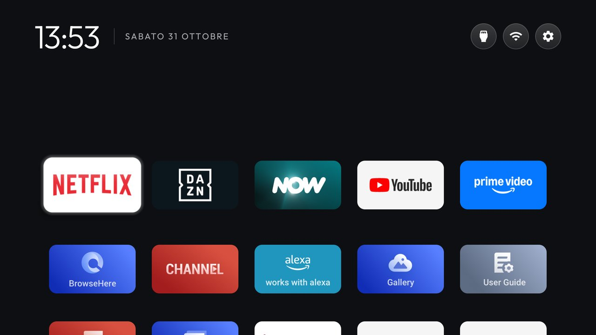
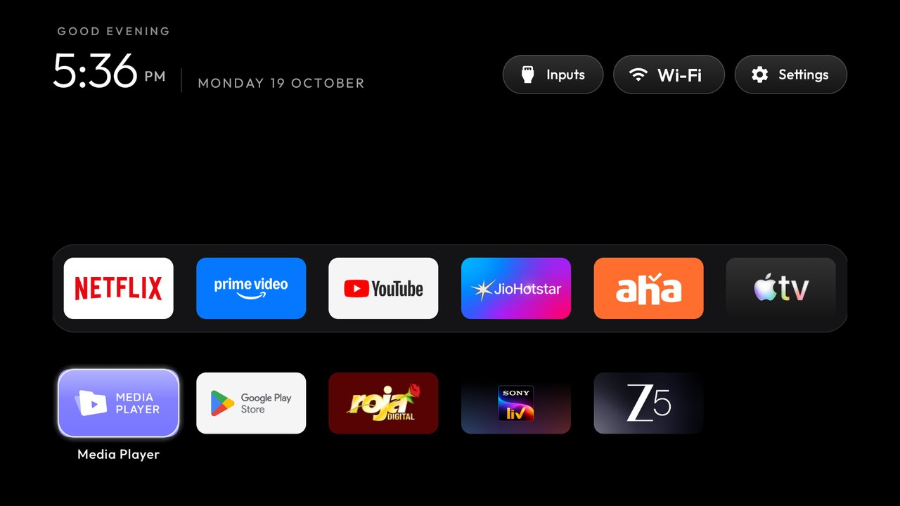

# CleanYourTV para Android

**Limpia tu Android TV o Google TV desde tu celular. Sin computadora, sin cables y sin root.**
Quita la publicidad, el rastreo y las apps que no usas, pon una pantalla de inicio estilo Apple TV con el tema que más te guste y tu propio fondo de pantalla.

### [⬇️ Descargar la última versión](../../releases/latest)

🇲🇽 [Español](#-español) &nbsp;·&nbsp; 🇺🇸 [English](#-english) &nbsp;·&nbsp; 🇧🇷 [Português](#-português)

---

## 🇲🇽 Español

**CleanYourTV para Android** es una **adaptación del proyecto [CleanYourTV](https://github.com/Gathin23/cleanyourtv) para personas que no tienen una computadora**. El proyecto original limpia tu TV desde una PC con un asistente de programación. Esta app hace lo mismo **desde tu celular Android**, conectándose a tu TV por la red Wi-Fi de tu casa.

**Nada se desinstala**: las apps solo se desactivan, y todo se puede restaurar desde la misma app.

| | |
|:---:|:---:|
|  |  |
| *Pantalla de inicio estilo Apple TV* | *Entradas HDMI, AV y TV en vivo* |
|  |  |
| *Cuadrícula con marcador de vidrio* | *Protector de pantalla con reloj* |

Capturas del launcher del proyecto original [CleanYourTV](https://github.com/Gathin23/cleanyourtv) (licencia MIT).

### ✨ Qué hace

| | Función | Detalle |
|---|---|---|
| 📡 | **Encuentra tu TV sola** | Busca en tu red Wi-Fi las TVs con depuración activa y te muestra **su nombre o modelo, la IP y el puerto**. También puedes escribirlos a mano y **cancelar la vinculación** cuando quieras. |
| 🧭 | **Guía paso a paso** | Te explica cómo activar la depuración en tu TV, con botones **Atrás y Siguiente**. |
| 🧹 | **Limpia tu TV** | Desactiva publicidad, telemetría y apps preinstaladas usando las **481 listas probadas** por la comunidad en TVs reales de 131 marcas. |
| ⭐ | **Recomendadas** | Te marca lo que la mayoría de las TVs probadas desactivan y te dice en cuántas se desactivó cada app. |
| 📋 | **Lista de tu modelo** | Aplica la lista de un modelo igual o parecido al tuyo; primero salen los de tu marca. |
| 🔒 | **Protección** | No deja tocar los paquetes base de Android, Play Store, los servicios de Google, tu pantalla de inicio ni tu teclado. |
| 🍎 | **Inicio estilo Apple TV** | Instala el launcher del proyecto original: dock con tus apps favoritas, cuadrícula, entradas HDMI, reloj y protector de pantalla. |
| 🎨 | **30 temas** | Elige el que más te guste con su vista previa. Se descarga solo cuando lo aplicas, para que la app pese poco. |
| 🖼️ | **Tu propio fondo** | Elige cualquier imagen de tu celular; se recorta a 16:9 y queda como fondo de la pantalla de inicio. |
| 📊 | **Pantalla de progreso** | Ves cada paso mientras se aplica: apps, launcher, tema y fondo. Al terminar, **la TV se reinicia sola**. |
| ↩️ | **Restaurar** | Reactiva lo que desactivaste o regresa a tu pantalla de inicio original cuando quieras. |
| 🌗 | **Claro y oscuro** | Sigue el tema de tu celular. |

### 🎨 Temas

| | | | |
|:---:|:---:|:---:|:---:|
|  |  |  |  |
| *Aurora* | *Glass* | *Minimal* | *Six Columns* |

Algunos de los 30 temas de la comunidad CleanYourTV.

### 📥 Instalar y usar

1. Descarga `CleanYourTV-v1.1.apk` desde [**Releases**](../../releases/latest) e instálalo en tu celular. Android te pedirá permitir instalar apps de esta fuente.
2. **En tu TV:** Ajustes → Preferencias del dispositivo → Información → presiona **7 veces** *Compilación*. Regresa → Opciones para desarrolladores → activa **Depuración USB** y, si aparece, **Depuración de red / ADB**.
3. Conecta tu celular y tu TV a **la misma red Wi-Fi**.
4. Abre **CleanYourTV**, toca **Buscar TVs en mi red** (o escribe la IP) y acepta en la TV el mensaje *"¿Permitir la depuración?"*.
5. Elige qué limpiar, el launcher, el tema y tu fondo, y toca **Aplicar y reiniciar**.

### 📺 Compatibilidad

| TV | ¿Funciona? |
|---|---|
| **Android TV y Google TV** (Sony, TCL, Hisense Android, Philips, Xiaomi, Chromecast, cajas Android…) | ✅ Limpieza, launcher, temas y fondo. |
| **Fire TV** | ⚠️ Solo limpieza: Fire OS no permite cambiar la pantalla de inicio. |
| **Samsung (Tizen), LG (webOS), Roku, Vizio, Hisense VIDAA** | ❌ No tienen ADB. |

> Funciona con la depuración por red clásica (puerto 5555). Las TVs que solo ofrecen la "Depuración inalámbrica" con código de emparejamiento de Android 11+ todavía no son compatibles.

### 🌐 Idiomas

La app está en **español, inglés y portugués**, y cambia sola según el idioma de tu celular.

### 💚 Uso libre

Esta app es **solo para uso libre, sin fines de lucro ni de recaudación**. No vende nada, no tiene anuncios, no pide cuentas y no recopila datos. La conexión es directa entre tu celular y tu TV, dentro de tu red.

> Este repositorio distribuye únicamente el **APK** de la app. El código fuente no es público.

---

## 🇺🇸 English

**CleanYourTV for Android** is an **adaptation of [CleanYourTV](https://github.com/Gathin23/cleanyourtv) for people who don't have a computer**. It cleans your Android TV or Google TV **from your Android phone** over your home Wi-Fi: no PC, no cables, no root, and nothing is uninstalled.

- **Finds your TV automatically** on your network, or type the **IP and port**.
- **Removes ads, tracking and bloatware** using **481 community-tested lists**, with core packages protected.
- **Installs the Apple TV style launcher** from the original project.
- **30 themes** with previews, plus **your own wallpaper** from your phone.
- **Progress screen** for every step, and the **TV restarts automatically** at the end.
- **Restore** anything at any time. Light and dark mode. **Spanish, English and Portuguese.**

Download the APK from [**Releases**](../../releases/latest). Requires Android 8.0+ on the phone. **Free use only, non-profit, no fundraising.**

---

## 🇧🇷 Português

**CleanYourTV para Android** é uma **adaptação do [CleanYourTV](https://github.com/Gathin23/cleanyourtv) para quem não tem computador**. Limpa sua Android TV ou Google TV **pelo celular Android**, na rede Wi-Fi de casa: sem PC, sem cabos, sem root e sem desinstalar nada.

- **Encontra a TV sozinho** na rede, ou digite o **IP e a porta**.
- **Remove anúncios, rastreamento e apps desnecessários** com **481 listas testadas** pela comunidade.
- **Instala o launcher estilo Apple TV** do projeto original, com **30 temas** e **seu próprio fundo**.
- **Tela de progresso** e a **TV reinicia sozinha** no final. Tudo pode ser restaurado.

Baixe o APK em [**Releases**](../../releases/latest). **Uso livre, sem fins lucrativos nem de arrecadação.**

---

### 👤 Créditos / Credits

**App para Android:** Manuel Morales ([@Disasterxz](https://github.com/Disasterxz)): adaptación y desarrollo

**Proyecto original:** [CleanYourTV](https://github.com/Gathin23/cleanyourtv) de [@Gathin23](https://github.com/Gathin23) y su comunidad: listas de paquetes, launcher, temas y capturas, con licencia MIT

Esta app no es un producto oficial del proyecto CleanYourTV. Las marcas de TV pertenecen a sus respectivos dueños.
This app is not an official product of the CleanYourTV project. TV brands belong to their respective owners.

